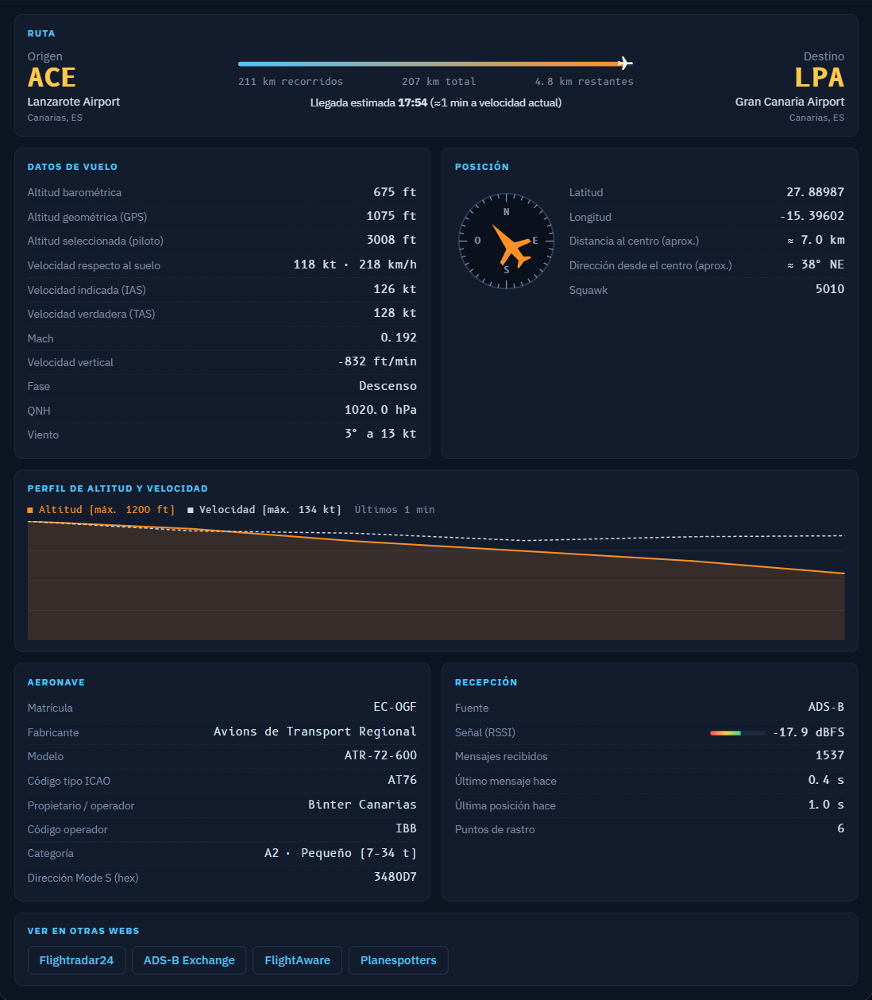

# Radar ADS-B

Interfaz web en directo para mi receptor ADS-B (Raspberry Pi + RTL-SDR con readsb y tar1090): un mapa 3D con los aviones a su altitud real, sus rastros y una ficha de cada avión con foto, ruta, modelo, aerolínea y matrícula.

Se ve en **[roypara.com/radar/](https://roypara.com/radar/)**, dentro de mi portfolio ([crazyro6/roypara.com](https://github.com/crazyro6/roypara.com)).



*Ficha de un avión (sin la foto de Planespotters, que es de su autor y no se redistribuye aquí).*

## De dónde salen los datos

```
antena → Raspberry Pi (readsb + tar1090) → Cloudflare Tunnel + Access → Worker de roypara.com (/api/*) → esta página
```

La página ya no habla con la Pi: lee la API pública del portfolio, que está en el mismo dominio.

- **`/api/aircraft.json`**: el `aircraft.json` de tar1090 con la misma forma y los mismos nombres de campo. El Worker deja pasar solo una lista cerrada de campos y quita los que delatan dónde está la antena (`r_dst`, `r_dir`, `rr_lat`, `rr_lon`). Si la Pi tiene la base de datos de aviones, trae también matrícula (`r`), tipo ICAO (`t`), modelo (`desc`) y operador (`ownOp`).
- **`/api/receiver.json`**: `{lat, lon, refresh}` con el **centro aproximado** del radar (a ~1 km), no la posición de la antena.

El Worker cachea 5 s, así que la página lee cada 5 s, y nunca más rápido: no traería datos nuevos y gastaría cuota (plan gratuito de Cloudflare, compartida con la portada). Con la pestaña oculta no lee.

**Privacidad:** la posición exacta de la antena no aparece en ningún sitio, ni en el código ni en el navegador. Las distancias, la dirección desde el centro y los anillos de alcance se miden desde el centro aproximado, y la página los marca como aproximados (≈). En el mapa, el centro se dibuja como una mancha de 2 km, no como un punto.

**Fichas de cada avión:**
- Matrícula, tipo y modelo: de la Pi si los trae y, si no, de [HexDB](https://hexdb.io).
- Aerolínea y ruta: de HexDB (si HexDB no tiene la aerolínea, se usa el operador de la Pi).
- Foto: de [Planespotters.net](https://www.planespotters.net), siempre citando al autor y enlazando la foto.

Se pide una vez por avión y vuelo.

## Stack

React 19 + Vite, MapLibre GL (mapa y relieve 3D) y deck.gl (aviones, rastros y etiquetas), con CSS sin frameworks. La fuente de los datos es B612 Mono, la de las pantallas de cabina de Airbus, como en el portfolio.

Mapas de [OpenFreeMap](https://openfreemap.org), satélite de Esri y relieve de AWS Terrain Tiles.

## Desarrollo

Requisitos: Node.js 20+.

```bash
npm install
npm run dev
```

En local no hay Worker: el proxy de Vite (`vite.config.js`) manda `/api/*` a la API pública de `https://roypara.com`, así que se ve lo mismo que en la web y sin problemas de CORS.

Desde casa también se puede leer directamente de la Pi, por la red local:

```bash
RADAR_PI=<ip-de-la-pi> npm run dev
```

En PowerShell: `$env:RADAR_PI="<ip-de-la-pi>"; npm run dev`.

Así solo `aircraft.json` sale de la Pi (de `/adsbx/data/aircraft.json`). `receiver.json` sigue saliendo de la API pública, porque el de la Pi trae la posición exacta.

Para usar otra API, se puede cambiar la ruta base con `VITE_RADAR_URL` (por defecto, `/api`).

## Publicar en roypara.com

La página es estática (`base: './'`) y se sirve desde la carpeta `public/radar/` del portfolio, en el mismo dominio que la API:

```bash
npm run publicar
```

Este comando compila directamente en `E:/Proyectos Otros/Portfolio personal/public/radar`. Si tu portfolio está en otra carpeta, cambia la ruta en `package.json`. Después hay que hacer commit y push en el repo del portfolio: Workers Builds lo despliega solo.
